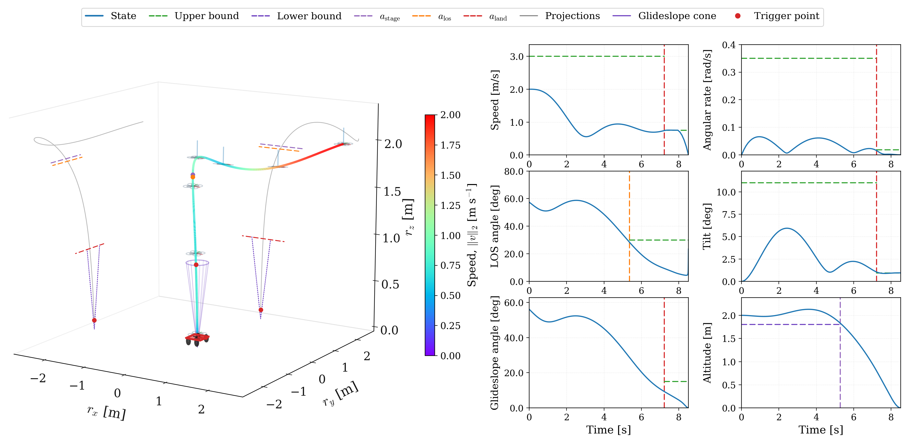

# ctcs_stc — continuous-time and state-triggered constraints for Aligator

A header-only C++ interface that adds two kinds of path constraint to
[Aligator](https://github.com/Simple-Robotics/aligator)'s constrained solver, ProxDDP:

- **CTCS**: continuous-time constraint satisfaction. A path constraint
  `c(x,u) <= 0` is enforced *between* the discretization nodes, not only at them.
- **STC**: state-triggered constraints, `g(x) < 0  ==>  c(x,u) <= 0`
  ("below 1.5 m, stay inside the glideslope cone").

Each one becomes an ordinary Aligator stage constraint, a row `c_k(x_k, u_k) <= 0` on stage
`k`, so the solver itself is unchanged.



`examples/stc_landing.cpp`: a quadrotor landing with eight state-triggered rules in one CTCS row
per interval, free final time, solved by ProxDDP.

## Method
This repo implements published methods; it does not introduce a new formulation:
state-triggered constraints (STC, Szmuk et al.), continuous-time constraint satisfaction
(CTCS, Elango et al.), and continuous-time compound state-triggered constraints (CT-cSTC,
Uzun et al., [UW-ACL/CT-cSTC](https://github.com/UW-ACL/CT-cSTC)). The solver is
[Aligator](https://github.com/Simple-Robotics/aligator)'s ProxDDP, used unmodified as a git
submodule. See [Citing](#citing).

For interval `k` the interface computes

```
I_k = ∫_{t_k}^{t_k+1} H(x(t), u(t)) dt,     H = Σ_i w_i [-g_i(x)]_+^2 [s_i c_i(x,u)]_+^2
```

along the stage's own dynamics starting at `x_k` (the RK4 stage points of
`ctcs_stc::IntegratorRK4`, Simpson weights), and emits `I_k - eps <= 0`. `I_k` depends on
`(x_k, u_k)` only, so **no accumulator state is added**. This is the non-augmented form
(Elango 2025, eq. 34). It also holds for nonlinear dynamics, and it is numerically identical to
integrating an extra state `y' = H` with the same RK4 steps (checked in `tests/`).

## Layout
```
.
├── include/ctcs_stc/
│   ├── spec.hpp                  rules: triggers, consequences, forms, eps
│   ├── integrator_rk4.hpp        RK4 for Aligator ODE models (free time, substeps, projection)
│   ├── interval_constraint.hpp   the rows: aligator::StageFunctionTpl from a Spec and the integrator
│   └── USAGE.md                  how to use the interface
├── examples/
│   ├── pointmass_sphere.cpp      CTCS: point mass past a sphere (Elango 2025 setup)
│   ├── point_mass.hpp            point-mass ODE and costs
│   ├── stc_landing.cpp           STC: quadrotor landing, free final time, 8 rules in one CTCS row
│   └── quadrotor.hpp             quadrotor ODE, control scaling, quaternion projection
├── tests/
│   └── test_spec.cpp             FD Jacobians, row == augmented accumulator, curvature
├── docs/                         figures
├── aligator/                     Aligator as a git submodule (upstream main)
├── CITATIONS.bib                 BibTeX: Aligator/ProxDDP, STC, CTCS, CT-cSTC
└── CMakeLists.txt
```

## Installation
```bash
git clone --recursive https://github.com/mattnoh/CTCSTCDDP.git
cd CTCSTCDDP
```
`--recursive` also fetches Aligator into `aligator/`. Install it by following
[Aligator's instructions](https://github.com/Simple-Robotics/aligator#installation), then build
this repo against that install:
```bash
cmake -S . -B build -DCMAKE_PREFIX_PATH=<aligator install prefix>
cmake --build build -j
ctest --test-dir build
./build/stc_landing
```
If the run cannot find Aligator's libraries, add its `lib` folder and that of its dependencies to
`LD_LIBRARY_PATH`.

To use the interface in your own project (C++17, header-only):
```cmake
add_subdirectory(CTCSTCDDP)
target_link_libraries(my_ocp PRIVATE ctcs_stc::ctcs_stc)
```

## Usage
See [`include/ctcs_stc/USAGE.md`](include/ctcs_stc/USAGE.md) for how to write an OCP with this interface.

## Limitations
- Vector-space states only (`ndx == nx`). `stc_landing` carries the quaternion as a plain
  R^4 block renormalized after each step, not as a manifold state.
- `IntervalConstraint` reuses its integration on exact `(x, u)`. If the ODE reads externals
  that change between solves, rebuild the stages.

## Citing
If you use this interface, please cite the works it builds on:

```bibtex
% Solver
@misc{aligatorweb,
  author = {Jallet, Wilson and Bambade, Antoine and El Kazdadi, Sarah and Carpentier, Justin and Mansard, Nicolas},
  title  = {aligator},
  url    = {https://github.com/Simple-Robotics/aligator}
}

@article{jalletPROXDDPProximalConstrained2025,
  title   = {PROXDDP: Proximal Constrained Trajectory Optimization},
  author  = {Jallet, Wilson and Bambade, Antoine and Arlaud, Etienne and {El-Kazdadi}, Sarah and Mansard, Nicolas and Carpentier, Justin},
  year    = {2025},
  journal = {IEEE Transactions on Robotics},
  volume  = {41},
  pages   = {2605--2624},
  doi     = {10.1109/TRO.2025.3554437}
}

% State-triggered constraints (STC)
@article{szmukSuccessiveConvexificationRealTime2020,
  title   = {Successive Convexification for Real-Time 6-{DoF} Powered Descent Guidance with State-Triggered Constraints},
  author  = {Szmuk, Michael and Reynolds, Taylor P. and A{\c{c}}{\i}kme{\c{s}}e, Beh{\c{c}}et},
  journal = {Journal of Guidance, Control, and Dynamics},
  volume  = {43},
  number  = {8},
  pages   = {1399--1413},
  year    = {2020},
  doi     = {10.2514/1.G004549}
}

% Continuous-time constraint satisfaction (CTCS)
@article{elangoContinuoustimeSuccessiveConvexification2025,
  title   = {Continuous-time successive convexification for constrained trajectory optimization},
  author  = {Elango, Purnanand and Luo, Dayou and Kamath, Abhinav G. and Uzun, Samet and Kim, Taewan and A{\c{c}}{\i}kme{\c{s}}e, Beh{\c{c}}et},
  journal = {Automatica},
  volume  = {180},
  pages   = {112464},
  year    = {2025},
  doi     = {10.1016/j.automatica.2025.112464}
}

% Continuous-time compound state-triggered constraints (CT-cSTC)
@inproceedings{uzunSequentialConvexProgramming2025,
  title     = {Sequential Convex Programming for 6-{DoF} Powered Descent Guidance with Continuous-Time Compound State-Triggered Constraints},
  author    = {Uzun, Samet and A{\c{c}}{\i}kme{\c{s}}e, Beh{\c{c}}et and Carson, John M.},
  booktitle = {AIAA SciTech 2025 Forum},
  year      = {2025},
  doi       = {10.2514/6.2025-1895},
  note      = {Code: \url{https://github.com/UW-ACL/CT-cSTC}}
}
```
